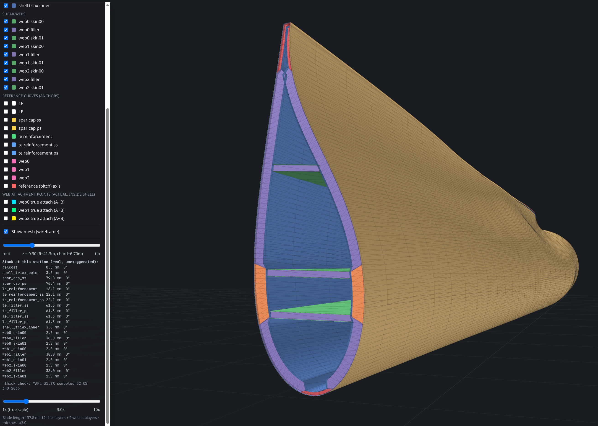

# IEA 22 MW RWT — Blade Ply-Layup Viewer

Interactive 3D viewer of the [IEA 22 MW Reference Wind Turbine](https://github.com/IEAWindTask37/IEA-22-280-RWT) blade, showing its **real composite ply layup** — actual chord, twist, prebend, blended airfoils, and the 12 shell layers + 3 shear webs straight from the WindIO YAML.

**[▶ Live demo](https://basemrajjoub.github.io/iea22mw-blade-viewer/)** · single self-contained `index.html`, no build step.

https://github.com/user-attachments/assets/88ad2781-a8b6-405f-81f3-a04ad9e11a13

## Run it

- **Online:** open the live demo link.
- **Local:** open `index.html` in any modern browser (needs internet on first load — three.js is pulled from a CDN).

## Controls

- **Navigation** — left-drag orbits about the exact surface point under the cursor, right/shift-drag pans (the grabbed point stays under the cursor), wheel zooms toward the cursor. Touch: one finger orbits, two fingers pan and pinch-zoom. A small gizmo marks the pivot while you move.
- **Layer checkboxes** — show/hide each shell ply, shear web, reference curve, or the pitch axis.
- **Cut slider** — clip the blade along the span and fill the revealed cross-section live.
- **Exaggeration slider** — scale ply thickness 1×–10× (real plies are thin relative to the blade).
- **Wireframe** — overlay the mesh.
- **Rotor & pitch** — rotor speed and blade pitch sliders (pitch applies to both the detailed blade and the full turbine).
- **Wind & inflow** — leading-edge velocity triangles (axial U(1−a), rotational Ωr, relative W) at five span stations, with wind speed and axial-induction sliders and a tip readout of inflow angle and angle of attack.
- The side panel lists the exact, unexaggerated ply stack (thickness in mm + fiber angle) at the current cut station.

## How it works

`index.html` embeds the blade definition as JSON (exported from the WindIO YAML) and builds every ply as an offset shell in [three.js](https://threejs.org/). Ply-drop edges render as genuine hard steps — this is a geometry-verification view, not a beautified render.

## Deploy to GitHub Pages

1. Push this repo to GitHub.
2. **Settings → Pages → Build from a branch → `main` / root.**
3. Open `https://<user>.github.io/<repo>/`.

## License

[MIT](LICENSE) © 2026 Basem Rajjoub. Blade geometry derives from the IEA 22 MW RWT (WindIO), also open-source.
